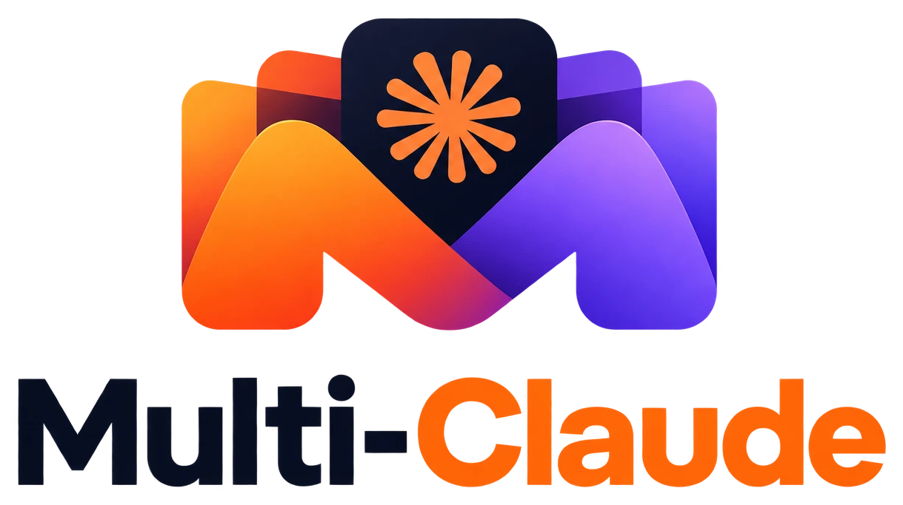

<div align="center">



**Run several Claude Desktop accounts side by side — each with its own window, sign-in and usage limits.**

[](https://github.com/moshiuzzaman/multi-claude/releases/latest)
[](#install)
[](LICENSE)
[](CONTRIBUTING.md#development)

[Install](#install) · [Why it's different](#why-its-different) · [Features](#features) · [Docs](docs/GUIDE.md) · [Contributing](CONTRIBUTING.md)

</div>

Claude Desktop signs in one account at a time. Multi-Claude gives each account its own
profile folder and launches Claude against it — the way Chrome keeps profiles — so work and
personal can be **open at the same time**, each in its own window, with its own taskbar
button, colour and usage limits.

> Not affiliated with, endorsed by, or connected to Anthropic. "Claude" is Anthropic's trademark.

## Why it's different

Most tools in this space are **account switchers for the Claude Code CLI** — they rewrite a
config file so one account is active at a time — or **usage monitors** that read local logs.
Multi-Claude is neither.

- **Real apps running at once, not a config swap.** Every account open together, signed in,
  with its own chats and tray icon. Nothing is swapped out, so nothing has to be swapped back.
- **It never touches a credential.** No reading, copying, exporting or syncing of tokens,
  cookies or sign-ins. You sign in inside Claude's own window; live usage limits come from
  Anthropic's own Claude Code (`claude auth login`, then `/usage`), which is allowed to
  report them. [Why that matters →](docs/GUIDE.md#usage-limits)
- **It refuses the features that dodge usage limits.** No auto-switch at a limit, no pooling
  or "next available account", no parallel launching, no profile cloning. Permanent
  decisions, not gaps — PRs adding them are declined.
- **Windows gets first-class treatment.** Each account's window gets its own taskbar button
  and tray icon in the account's colour and letter, using standard shell properties. Claude
  itself is never patched or repacked.

| | CLI switchers<br><sub>cc-switch, claude-swap, clauth, cux</sub> | Usage monitors<br><sub>CC-Usage-Monitor, CodexBar</sub> | **Multi-Claude** |
|---|:---:|:---:|:---:|
| Several Claude **Desktop** accounts at once | — | — | **Yes** |
| Per-account Session + Weekly limits, with resets | Some | Yes | **Yes** |
| Usage without any extra sign-in | — | Partly | **Yes** |
| Reads or moves your tokens | Often | Reads logs | **Never** |
| Auto-switch, pooling, failover | Common | — | **Refused** |
| Per-account taskbar + tray icon (Windows) | — | — | **Yes** |

<sub>From the feature-by-feature research in [`docs/FEATURE-ROADMAP.md`](docs/FEATURE-ROADMAP.md)
(November 2026). Good tools, different problem — go read them.</sub>

## Features

- **Accounts** — add, rename, delete and shortcut profiles from the app; no scripts to
  edit. Your existing account and any `Claude_Work` folder are imported in place on first run.
- **One button per account** that knows the state: Launch, Show, or Close.
- **Usage limits per account** — Session (5hr) and Weekly, read from what Claude already
  records, with **no extra sign-in**. Optional live limits add reset times and every meter
  the server reports, without ever calling a model.
- **Limit alerts** at levels you pick (50–95%, plus "limit reached"), once per window.
  Information only — alerts never switch, launch or close anything.
- **Usage history** per account over 7 or 30 days: limit-reached counts, busiest day, weekly
  line, daily session bars.
- **Per-account identity on Windows** — its own taskbar button and tray icon, in the
  account's colour and letter.
- **Same-account warning** when two profiles sign in to one Claude account.
- **Use in VS Code / Terminal** — point Claude Code at one account you own, without signing
  in again.
- **Tray / menu bar** with every account's figures, plus launch and close.
- **Launch history and per-profile disk usage**, with a cache purge.
- **Automatic updates** from GitHub Releases, SHA-512 verified. Nothing downloads without a click.

[Full documentation →](docs/GUIDE.md)

## Install

Download from the [**Releases page**](https://github.com/moshiuzzaman/multi-claude/releases/latest):

| File | For |
|---|---|
| `Multi-Claude-Setup-<version>.exe` | Windows — installs and updates itself |
| `Multi-Claude-<version>-portable.exe` | Windows — no install |
| `Multi-Claude-<version>-arm64.dmg` / `-x64.dmg` | macOS — Apple Silicon / Intel |

The builds are not code-signed, so the first run needs one extra step: on Windows,
SmartScreen → **More info** → **Run anyway**; on macOS, right-click the app → **Open** →
**Open**. You also need [Claude Desktop](https://claude.ai/download) — Multi-Claude launches
it, it does not replace it.

**The macOS build has not been tested on a real Mac yet.** See [macOS](docs/GUIDE.md#macos).

### From source

Needs [Node.js 22+](https://nodejs.org).

```bash
git clone https://github.com/moshiuzzaman/multi-claude.git
cd multi-claude
npm install
npm start
```

## Quick start

1. **Open Multi-Claude** — your existing Claude account is already listed.
2. **Add an account**, give it a name and a colour.
3. **Launch it** — a fresh Claude window opens, signed out.
4. **Sign in with the email code**, not "Continue with Google" ([why](docs/GUIDE.md#known-limitations)).
   The app walks you through it once; after that, Launch opens it signed in.
5. *(Optional)* Click **Live limits** for up-to-the-minute figures with reset times.

## How it works

Claude Desktop is an Electron app, so it accepts Chromium's standard `--user-data-dir` flag.
Point it at a different folder and you get a completely separate login, exactly like Chrome
profiles. Multi-Claude manages those folders and launches Claude against them.

That is the whole mechanism. It does **not** modify, patch or repack Claude Desktop, and it
does **not** read, copy or back up your tokens, cookies or any file inside a profile. You
sign in to each account yourself, inside Claude's own window.

## Documentation

- [User guide](docs/GUIDE.md) — usage limits, alerts, history, tray, VS Code, file locations
- [Known limitations](docs/GUIDE.md#known-limitations) and [FAQ](docs/GUIDE.md#faq)
- [Feature roadmap](docs/FEATURE-ROADMAP.md) — 19 researched features with status
- [Contributing](CONTRIBUTING.md) — setup, architecture, the rules a PR must keep

## Contributing

Issues, fixes and testing are welcome — especially **anyone with a real Mac**. Start with
[CONTRIBUTING.md](CONTRIBUTING.md), which covers the dev setup and the rules every
contribution must keep.

## License

[MIT](LICENSE).

"Claude" and "Anthropic" are trademarks of Anthropic PBC. This project is independent and not
affiliated with them. It does not bundle, modify or redistribute Claude Desktop or Claude
Code; both come from Anthropic, and Claude Code is only ever downloaded from Anthropic's own
server, at your click.

## Acknowledgements

Built after studying how others solved neighbouring problems — all worth a look:
[cc-switch](https://github.com/farion1231/cc-switch) ·
[claude-swap](https://github.com/realiti4/claude-swap) ·
[clauth](https://github.com/uwuclxdy/clauth) ·
[cux](https://github.com/inulute/cux) ·
[CodexBar](https://github.com/steipete/CodexBar) ·
[Claude-Code-Usage-Monitor](https://github.com/Maciek-roboblog/Claude-Code-Usage-Monitor) ·
[KeyboardCowboy/multi-claude](https://github.com/KeyboardCowboy/multi-claude) ·
[claude-desktop-multi](https://github.com/sypnose-cloud/claude-desktop-multi)
